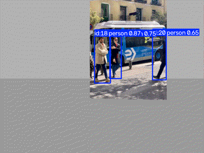

# ROS 2 Autonomous Surveillance System (Defense Robotics Simulation)

This project implements a closed-loop autonomy and target search algorithm for unmanned ground/air vehicles using **ROS 2 Humble**, **Gazebo**, **OpenCV**, and **Python**. Developed as part of robotics and artificial intelligence studies.



## Features

- **Simulation Environment:** Gazebo SITL integration with sensor suites.
- **Object Detection and Tracking:** YOLOv8 (Ultralytics) detects and tracks people in the camera stream. The robot steers toward the best target with a proportional controller and searches by rotating in place when no target is visible.
- **Autonomous Search/Patrol Mode:** Closed-loop velocity commands (`geometry_msgs/Twist`) allowing the robot to execute automated patrol routines when targets are out of sight.
- **ROS 2 Node Architecture:** Modular design separating sensor subscription and motor actuation.
- **Run Data Logging:** The `data_recorder` node logs position, velocity, commands and detections to CSV for later analysis.

## Tech Stack

- **Framework:** ROS 2 Humble
- **Physics Simulator:** Gazebo
- **Language:** Python (rclpy, OpenCV)
- **Perception:** YOLOv8 (Ultralytics, PyTorch CPU) and OpenCV
- **Analysis:** pandas, matplotlib, Plotly, Streamlit
- **Message Types:** `sensor_msgs/Image`, `geometry_msgs/Twist`, `nav_msgs/Odometry`

## Quick Start (GitHub Codespaces)

1. Go to **Code > Codespaces > Create codespace on main** (4 cores recommended).
2. When the setup finishes, the package is already built (`colcon build --symlink-install`).
3. Open port **6080** to see the Gazebo desktop in your browser (noVNC, default password: `vscode`).
4. Run the simulation: `ros2 launch savunma_drone sim.launch.py gui:=false` (see Usage below)

## Roadmap

- [x] Basic ROS 2 + Gazebo simulation with patrol mode
- [x] Codespaces development environment (devcontainer)
- [x] YOLOv8 target detection node + yaw/pitch tracking
- [x] Run data logging and analysis (pandas, Plotly, Streamlit dashboard)
- [x] Demo GIF
- [ ] Architecture diagram
- [ ] PX4 SITL + MicroXRCE-DDS (Offboard control)
- [ ] Gimbal payload design (Autodesk Inventor)

## Architecture

`camera -> /camera/image_raw -> target detection (YOLOv8) -> /detection -> control -> /cmd_vel`

Run data is recorded to `data/runs/*.csv` and analyzed in `analysis/`.

## Usage

```bash
source install/setup.bash

# Gazebo simulation: robot searches for a target panel, detects it with YOLOv8 and tracks it
ros2 launch savunma_drone sim.launch.py gui:=false

# Test without Gazebo: publish a sample image as the camera feed
ros2 run savunma_drone test_image_publisher
ros2 run savunma_drone target_detection --ros-args -p target_class:=person

# Analyze a recorded run (data/runs/*.csv)
python3 analysis/analyze_run.py
streamlit run analysis/dashboard.py
```

> Note: on a 2-core CPU-only Codespace the camera runs at only a few Hz.
